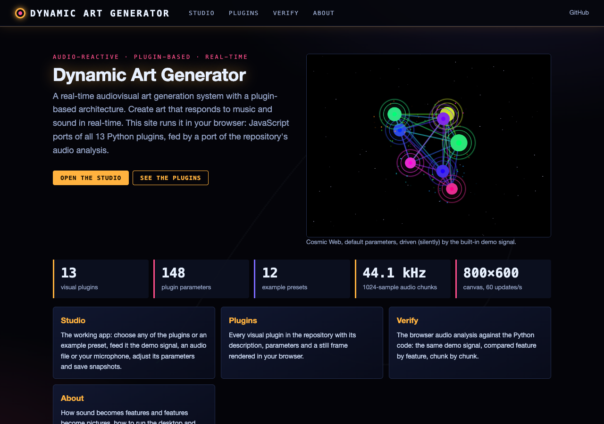
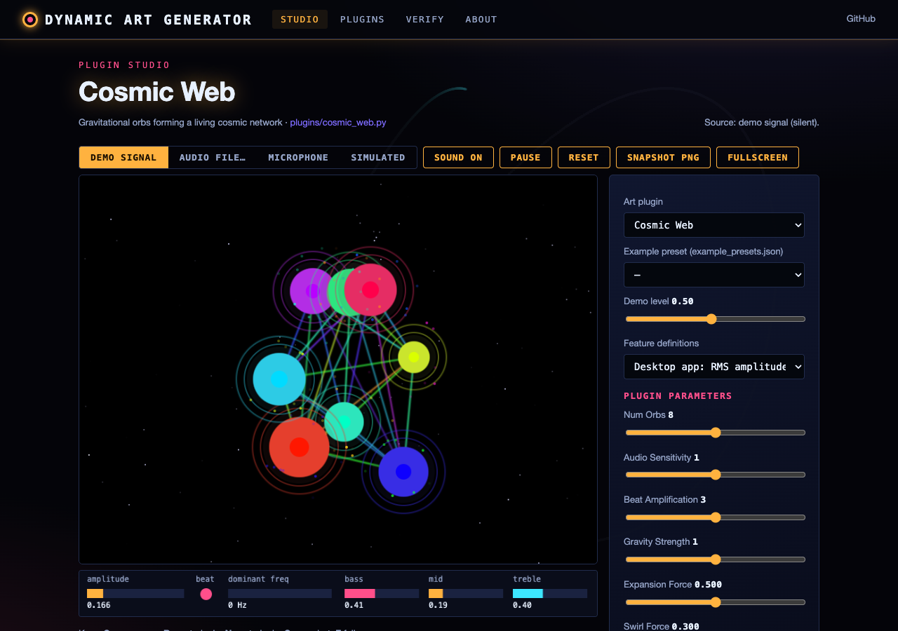
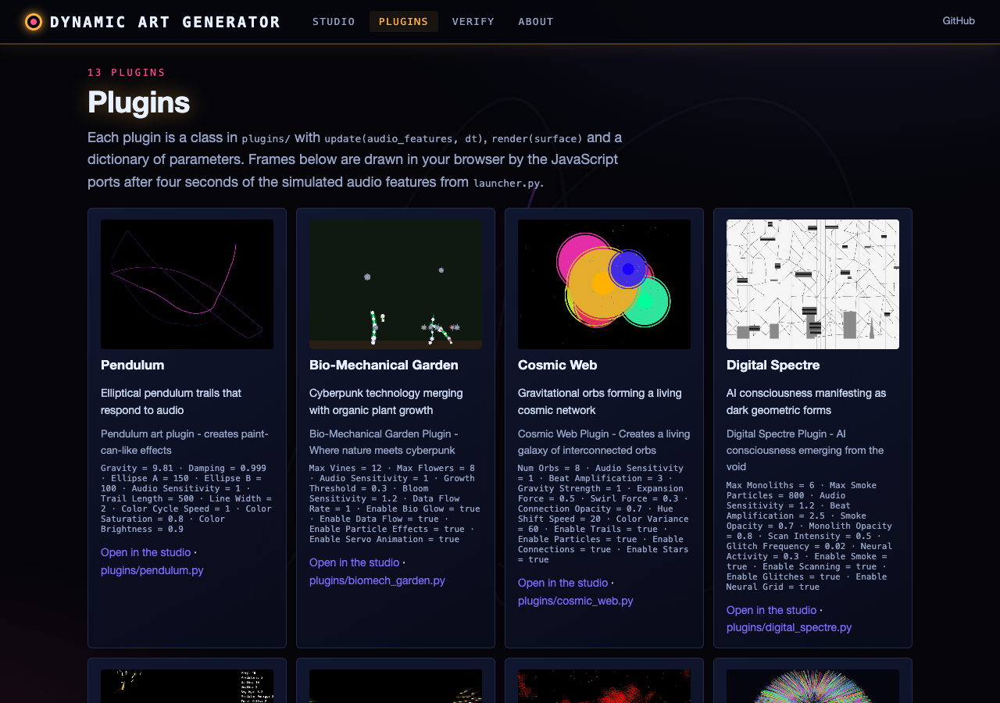
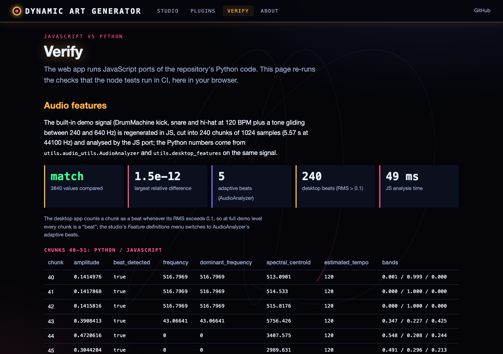

# Dynamic Art Generator

A real-time audiovisual art generation system with a plugin-based architecture. Create mesmerizing art that responds to music and sound in real-time.

## Features

- **Real-time Audio Processing**: Responds to microphone input or internal audio
- **Plugin System**: Extensible architecture for different art styles
- **Interactive GUI**: Full-featured interface with parameter controls
- **Multiple Art Styles** (13 plugins in `plugins/`, discovered automatically):
  - Pendulum: paint-can style elliptical pendulum trails
  - Particles: dynamic sand/smoke-like particle effects
  - Bio-Mechanical Garden, Cosmic Web, Digital Spectre, Musical Ecosystem, Musical Flock, Neural Flow,
    Noise Sphere, Particle Fountain, Quantum Jazz, Rehoboam, Space Junk
- **Audio Responsiveness**: Art reacts to amplitude, frequency, and beat detection
- **Parameter Tweaking**: Real-time adjustment of visual parameters

## Installation

### Prerequisites

Make sure you have Python 3.8+ installed on your system.

### Platform-Specific Setup

#### Windows
```bash
# Install Microsoft Visual C++ Build Tools if needed
# Download from: https://visualstudio.microsoft.com/visual-cpp-build-tools/
pip install -r requirements.txt
```

#### macOS
```bash
# Install portaudio using Homebrew
brew install portaudio
pip install -r requirements.txt
```

#### Linux (Ubuntu/Debian)
```bash
# Install audio development libraries
sudo apt-get update
sudo apt-get install portaudio19-dev python3-dev
pip install -r requirements.txt
```

### Quick Install
```bash
git clone https://github.com/gddickinson/dynamic-art-generator.git
cd dynamic-art-generator
pip install -r requirements.txt
python main.py
```

## Usage

### Basic Operation

1. **Launch the Application**:
   ```bash
   python main.py
   ```

2. **Select a Plugin**: Choose from available art plugins in the dropdown menu

3. **Configure Audio**: 
   - Check "Enable Audio Input" to use your microphone
   - Make sure your microphone permissions are enabled

4. **Start Generating**: Click "Start" to begin real-time art generation

5. **Adjust Parameters**: Use the sliders and controls to modify the visual effects

### Plugin Overview

#### Pendulum Plugin
Creates flowing, paint-can-like trails following elliptical pendulum physics:
- **Parameters**:
  - `gravity`: Controls the pendulum's restoring force
  - `damping`: How quickly the pendulum slows down
  - `ellipse_a/b`: Shape of the pendulum's orbit
  - `audio_sensitivity`: How much audio affects the motion
  - `trail_length`: Number of trail points to display

#### Particle Plugin
Generates dynamic particle systems that form and collapse around shapes:
- **Parameters**:
  - `max_particles`: Maximum number of particles
  - `spawn_rate`: How fast new particles are created
  - `particle_life`: How long particles live
  - `gravity/wind`: Environmental forces
  - `shape_size`: Size of the central formation shape

### Audio Features

The system analyzes audio input for:
- **Amplitude**: Overall volume level (RMS of each 1024-sample chunk)
- **Beat Detection**: adaptive (`utils/audio_utils.py` AudioAnalyzer): a chunk's energy above the average of the
  last 20 chunks by 1.5 standard deviations, at most one beat per 0.1 s
- **Frequency Analysis**: dominant frequency, bass/mid/treble energy shares, spectral centroid and more
  (AudioAnalyzer, `utils/desktop_features.py`)

These features drive various visual responses:
- Beat detection triggers particle bursts
- Amplitude affects motion intensity
- Frequency influences color and shape changes

## Architecture

### Core Components

1. **AudioProcessor**: Handles real-time audio input and analysis
2. **ArtPlugin**: Base class for all visual plugins
3. **DynamicArtGenerator**: Main application controller
4. **GUI Components**: Tkinter-based interface

### Plugin Development

To create a new plugin, inherit from `ArtPlugin` and implement:

```python
class MyPlugin(ArtPlugin):
    def __init__(self, surface_size):
        super().__init__("MyPlugin", surface_size)
        # Initialize your plugin
    
    def update(self, audio_features, dt):
        # Update plugin state based on audio and time
        pass
    
    def render(self, surface):
        # Draw to the pygame surface
        pass
    
    def get_parameters(self):
        # Return configurable parameters
        return {'param1': value1, 'param2': value2}
    
    def set_parameter(self, name, value):
        # Handle parameter changes
        pass
```

### File Structure

```
dynamic-art-generator/
├── main.py                 # Main application
├── requirements.txt        # Dependencies
├── README.md              # This file
├── config.json            # Configuration settings
├── launcher.py            # macOS launcher (checks, writes and runs macos_demo.py)
├── example_presets.json   # Example presets (plugin + parameters)
├── plugins/               # Plugin directory (13 plugins, auto-discovered)
│   ├── __init__.py        # ArtPlugin base class and PluginManager
│   ├── pendulum.py        # Pendulum plugin
│   ├── particles.py       # Particle plugin
│   └── ...                # biomech_garden, cosmic_web, digital_spectre, ecosystem, musical_flock,
│                          # neural_flow, noise_sphere, particle_fountain, quantum_jazz, rehoboam, space_junk
├── utils/                 # Utility modules
│   ├── __init__.py
│   ├── audio_utils.py     # Audio analysis (AudioAnalyzer), DrumMachine, smoothing
│   ├── desktop_features.py # The features main.py hands to the plugins
│   └── math_utils.py      # Mathematical helpers
├── tests/                 # pytest tests
└── web/                   # Web interface and static site (see below)
```

## Troubleshooting

### Audio Issues

**No audio input detected:**
- Check microphone permissions
- Verify microphone is not muted
- Try different sample rates in the code

**Installation errors with pyaudio:**
- Windows: Install Visual C++ Build Tools
- macOS: Install portaudio with Homebrew
- Linux: Install portaudio19-dev package

### Performance Issues

**Low frame rate:**
- Reduce particle count in particle systems
- Decrease trail length in pendulum plugin
- Close other audio applications

**High CPU usage:**
- Lower the audio sample rate
- Reduce plugin update frequency
- Disable audio processing temporarily

### Plugin Development

**Plugin not appearing:**
- Ensure plugin inherits from `ArtPlugin`
- Check the file is in `plugins/` (plugins are discovered automatically) and imports without errors
- Verify all required methods are implemented

## Advanced Features

### Custom Audio Sources

You can modify the audio processor to accept different input sources:
- File playback instead of microphone
- Network audio streams
- MIDI input for musical control

### Export Capabilities

The system can be extended to:
- Record video output
- Save high-resolution images
- Export parameter animations

### Real-time Performance

For live performance use:
- Use a dedicated audio interface
- Optimize plugins for consistent frame rates
- Set up MIDI controllers for parameter control

## Contributing

1. Fork the repository
2. Create a feature branch
3. Add your plugin or enhancement
4. Test thoroughly
5. Submit a pull request

### Plugin Guidelines

- Follow the established plugin interface
- Include comprehensive parameter controls
- Optimize for real-time performance
- Document all parameters clearly
- Test with various audio inputs

## License

Released under the [MIT licence](LICENSE).

## Inspiration

This project draws inspiration from:
- **1100 AMIANGELIKA**: Particle-based visual art
- **Physical pendulum art**: Paint-can pendulum installations
- **Audiovisual performance tools**: Real-time reactive graphics

## Technical Notes

### Audio Processing
- Uses PyAudio for real-time audio capture
- NumPy FFT-based analysis (`utils/audio_utils.py`); librosa is imported but not used for analysis
- 44.1kHz sample rate with 1024-sample buffers

### Graphics Rendering
- Pygame for 2D graphics and particle systems
- NumPy for efficient mathematical operations
- Real-time surface blitting to Tkinter canvas

### Performance Considerations
- Target 60 FPS for smooth animation
- Efficient particle culling and management
- Optimized trail rendering with alpha blending

---

*Create beautiful, responsive art that dances to the rhythm of sound!*

## Web interface and static site

**Live:** https://gddickinson.github.io/dynamic-art-generator/ (published from `main` by `.github/workflows/pages.yml`).

The site *is* the app: all 13 plugins are ported to JavaScript and run in your browser, driven by a port of the audio
analysis. Pick a plugin or an example preset, feed it the built-in demo signal (the DrumMachine's kick, snare and
hi-hat at 120 BPM with a gliding tone), an audio file, your microphone (after a click; nothing is uploaded) or the
simulated features of `launcher.py`, adjust the parameters and save PNG snapshots. The Verify page compares the JS
audio analysis and plugin parameters with the Python code in your browser.

| Home | Studio (Cosmic Web) |
|------|---------------------|
|  |  |
| **Plugins** | **Verify** |
|  |  |

### Run the web app
```bash
pip install -r requirements-web.txt
python run_web.py                 # http://127.0.0.1:8112
python -m pytest -q tests         # Python, API and node tests (node 22)
python scripts/build_static.py    # static site in site/
```
After changing a plugin or the audio analysis, mirror the change in `web/static/` and run
`python scripts/make_fixtures.py`; see `INTERFACE.md` for the file map.
